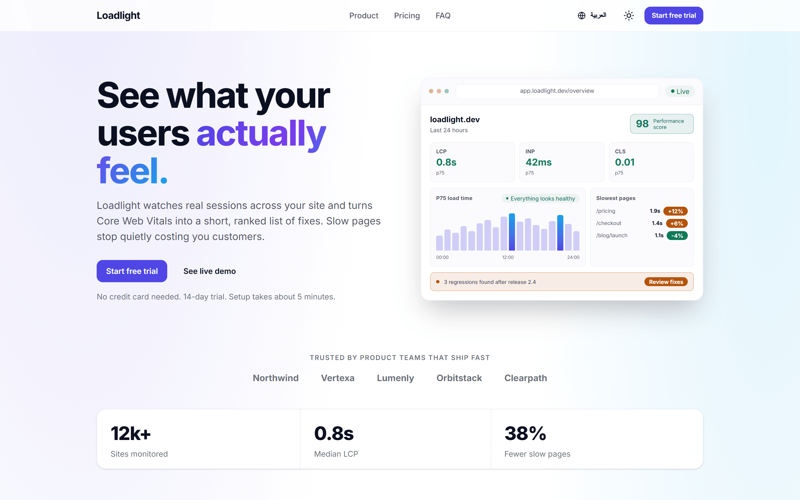
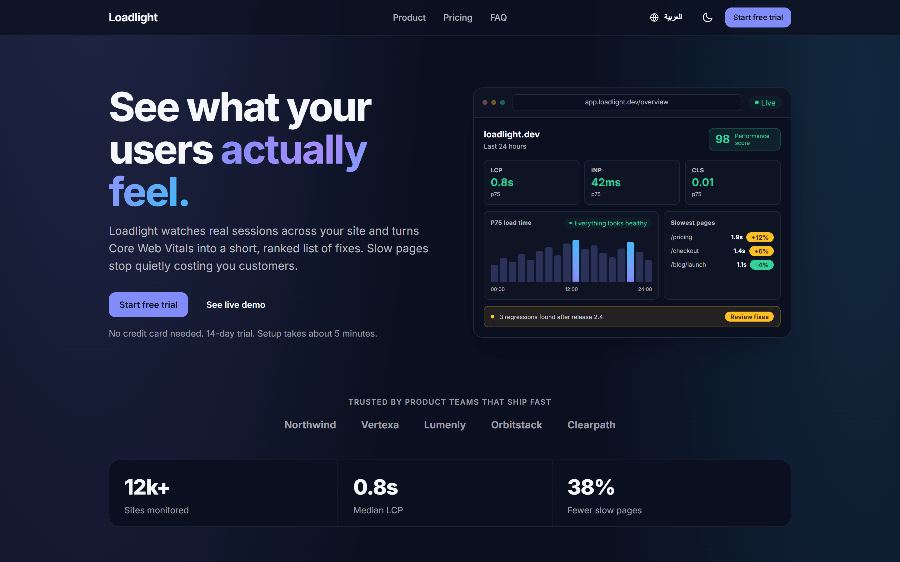
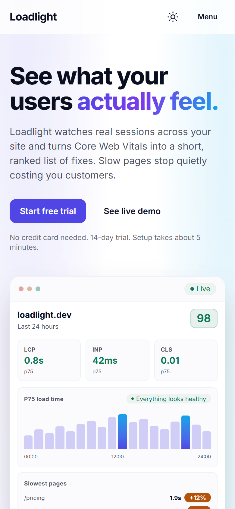
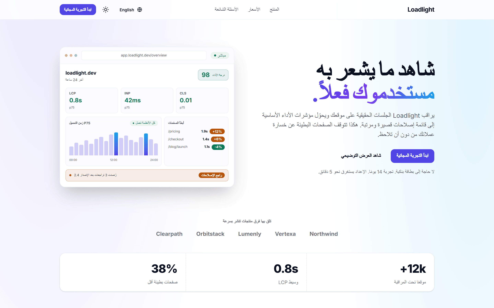
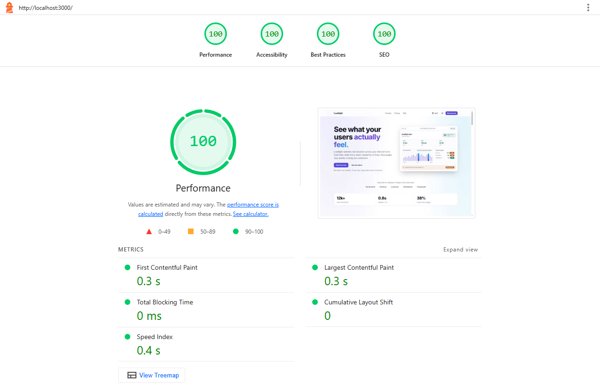
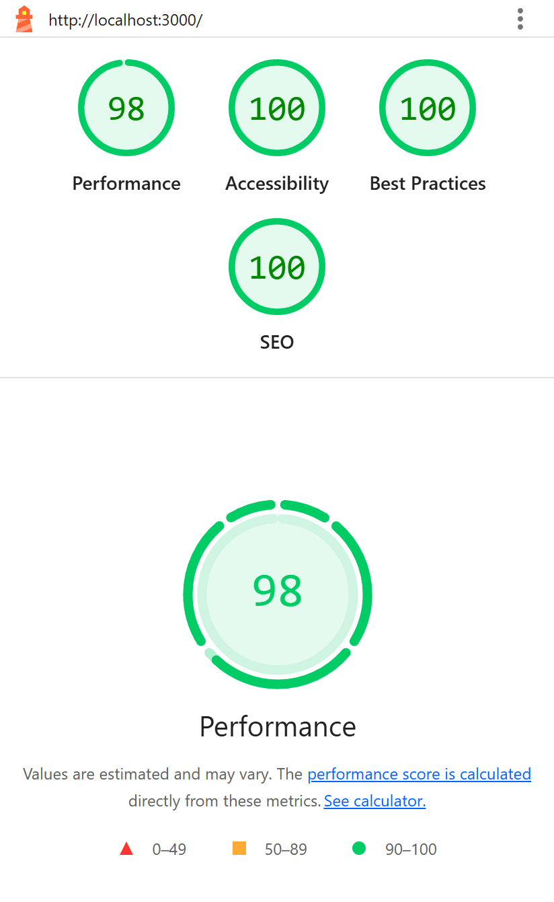

# Loadlight Landing Page

A bilingual marketing site for **Loadlight**, a real-user Core Web Vitals monitoring product. The site presents the product, pricing, testimonials, FAQ, and conversion flow in English and Arabic with light and dark themes.

Built with Next.js App Router, React Server Components, Tailwind CSS v4, and daisyUI. The interface uses no client-side React components. Theme and pricing state run on inline scripts and CSS only.

## Preview

| Desktop light | Desktop dark |
|:---:|:---:|
| [](docs/screenshots/desktop-light.png) | [](docs/screenshots/desktop-dark.png) |

| Mobile | Arabic RTL |
|:---:|:---:|
| [](docs/screenshots/mobile-light.png) | [](docs/screenshots/arabic-rtl.png) |

## Stack

| Technology | Version |
|---|---|
| Next.js | 16.4.6 |
| React | 19.3.1 |
| TypeScript | 7.0.2 |
| Tailwind CSS | 4.3.5 |
| daisyUI | 5.8.1 |
| Node.js | 20.9 or newer |

Tested on Node.js 26.13.0.

## Run locally

```bash
npm install
npm run dev
```

Open `http://localhost:3000`.

```bash
npm run typecheck
npm run build
npm start
```

No environment variables are required. Set `NEXT_PUBLIC_SITE_URL` to override the canonical and Open Graph base URL.

## Test results

All checks were run against the production build using headless Microsoft Edge at a 1440 px desktop viewport and a 390 px mobile viewport.

| Check | Result |
|---|---|
| TypeScript | Pass |
| Production build | Pass |
| Lighthouse desktop | 100 Performance, 100 Accessibility, 100 Best Practices, 100 SEO |
| Lighthouse mobile | 98 Performance, 100 Accessibility, 100 Best Practices, 100 SEO |
| Mobile metrics | LCP 1.0 s, TBT 160 ms, CLS 0 |
| Axe accessibility | 0 violations across EN/AR, light/dark, desktop/mobile |
| Responsive layout | No horizontal overflow at 375, 768, 1024, and 1440 px |
| Theme | Light default, persistent preference, no flash on load |
| Localization | EN/AR switching, cookie persistence, correct RTL layout |
| Pricing toggle | Monthly and annual states, keyboard accessible |
| Mobile navigation | Opens and closes correctly, keyboard accessible |
| Copy quality | No em/en dashes, middle dots, mojibake, or replacement characters |

No unit or end-to-end test suite is configured. Verification uses build, typecheck, browser, Lighthouse, and Axe checks.

### Lighthouse desktop

[](docs/screenshots/lighthouse-desktop.png)

### Lighthouse mobile

[](docs/screenshots/lighthouse-mobile.png)

## Features

- Real-user Core Web Vitals monitoring for LCP, INP, and CLS
- Regression alerts after releases
- Asset intelligence and oversized image detection
- SEO and internationalization audits
- CI performance gates and team reporting
- Three pricing plans, testimonials, expandable FAQ, and email CTA

## Implementation notes

- Next.js App Router with server-rendered pages and no React hydration for theme or billing state
- Theme stored in `localStorage` under the `theme` key and applied before paint
- Locale stored in an HttpOnly `locale` cookie and applied through `<html lang>` and `<html dir>`
- CSS-only monthly/annual pricing toggle using `:has()`
- Server-rendered metadata, JSON-LD, sitemap, robots file, and 1200x630 Open Graph image
- Inter and Cairo loaded through `next/font/google`

## Project structure

```text
app/                 Pages, layout, metadata routes, and global styles
components/          Header, footer, sections, icons, and interactive CSS components
lib/                 Site config, localization copy, and structured data
public/              Static assets and Open Graph image
docs/screenshots/    README screenshots
```

## Deployment

Deploy on Vercel with these settings:

| Setting | Value |
|---|---|
| Framework Preset | Next.js |
| Root Directory | `./` |
| Build Command | `npm run build` |
| Output Directory | Default `.next` |
| Install Command | `npm install` |